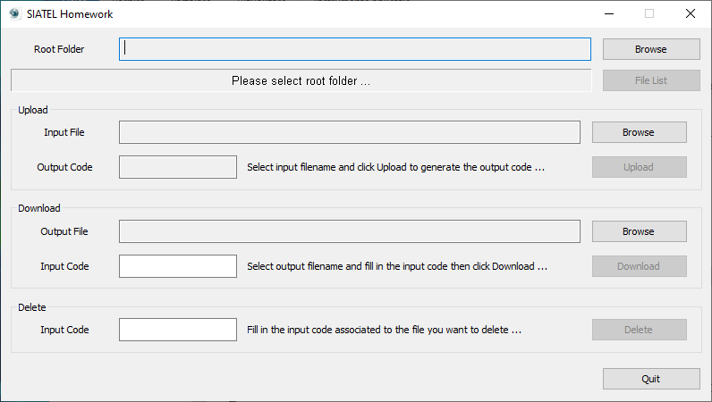

# BTreeAccess

**BTreeAccess** is a Windows desktop application, written in C++ with the Microsoft Foundation Class (MFC) library, that works as a small file store addressed by short codes: you upload a file, get a four-character code back, and later use that code to download or delete the file. It addresses the following problem: *create a file server with optimal access to files, with the restriction that each folder can store at most N files.*

The B-tree theory and a walk through the code are in the article [Introduction to B-trees: Concepts and Applications](https://www.codeproject.com/articles/Introduction-to-B-trees-Concepts-and-Applications). A copy is kept in this repository as [BTreeAccess.html](BTreeAccess.html).



> **Note:** the window title, the executable and the Visual Studio project keep the historical name *SIATEL Homework* (`SiatelHomework.exe`, `SiatelHomework.vcxproj`).

## Features

- Upload any file and receive a random four-character code (digits `0-9` and letters `A-Z`).
- Download or delete a stored file by entering its code.
- A **File List** window shows the number, code and path of every stored file.
- No folder holds more than *N* files or *N* subfolders.
- The index of the stored files is saved as `filelist.txt` in the root folder, so a store can be reopened later.
- A progress bar tracks each file copy.

## How It Works

- **Codes.** Each upload draws a random key that is not in use yet. The code is that key written in base 36 and padded to four characters; for example, the key 65535 is the code `1EKF`.
- **Index.** A hash table (`CNetworkHash`) maps every key to the slot and the relative path of its file. The table is loaded from `filelist.txt`, in the root folder, when you select the folder and is saved back when the application closes. Each line of the file holds `<key> <slot> <relative path>`.
- **Folder layout.** The slot of a file is the number of files already stored when it is uploaded. The slot is written in base *N* and each digit becomes one part of the path: the last digit is the file name (with the `.dat` extension) and every other digit is a folder name, each encoded like a code (four characters). *N* is the `BALANCED_TREE_ORDER` macro in `SiatelHomeworkExt.h`; it is currently 4 (a comment in the source says it should be 1000). With *N* = 4, slots 0-3 are `0000.dat` to `0003.dat` in the root folder, slot 4 is `0001\0000.dat`, slot 5 is `0001\0001.dat`, slot 16 is `0001\0000\0000.dat` and slot 20 is `0001\0001\0000.dat`, so no folder holds more than *N* files or *N* subfolders.
- **Deleting.** The file in the last slot is moved into the slot that was freed, which keeps the slots contiguous.
- **B-tree status.** `USE_HASH_METHOD` in `SiatelHomeworkExt.h` selects the index: `TRUE`, the default, uses the hash table. `FALSE` selects the B-tree class `CNetworkTree`, which is still unfinished: it implements only *B-Tree-Create* and *B-Tree-Search*, and the upload, download, delete and file list branches that would use it are empty.

## Getting Started

### Prerequisites

To build this project, you will need:

- Windows and Visual Studio 2026 (the project uses the MSVC v145 toolset)
- The **Desktop development with C++** workload, including the **C++ MFC for x64/x86 (Latest MSVC)** component
- A Windows 10 or Windows 11 SDK

### Building the Project

1. Clone the repository:
   ```bash
   git clone https://github.com/mihaimoga/BTreeAccess.git
   ```
2. Open `SiatelHomework.sln` in Visual Studio and select a configuration (`Debug` or `Release`) and a platform (`x64` or `Win32`).
3. Build the solution, or run `msbuild` from a **Developer Command Prompt for VS**:
   ```
   msbuild SiatelHomework.vcxproj /p:Configuration=Debug /p:Platform=x64
   ```

`SiatelHomework.exe` is created in `x64\Debug\` or `x64\Release\` for x64, and in `Debug\` or `Release\` for Win32. MFC is linked statically. Debug builds use warning level 4, and code analysis runs on every build.

### Running

Start `SiatelHomework.exe` (or press F5 in Visual Studio), then:

1. Click **Browse** at the top of the window and choose the root folder of the store.
2. To upload, choose a file with the **Browse** button of the *Upload* group and click **Upload**. The code of the stored file appears in the same group.
3. To download, choose the destination file with the **Browse** button of the *Download* group, type the code and click **Download**.
4. To delete, type the code in the *Delete* group and click **Delete**.
5. Click **File List** to see all the stored files.

There is no automated test suite, so validate changes by running the application.

## File Structure

- `SiatelHomework.vcxproj`, `SiatelHomework.sln`: Visual Studio project (the authoritative build definition) and solution
- `SiatelHomework.h` / `.cpp`: MFC application class (`CSiatelHomeworkApp`)
- `SiatelHomeworkDlg.h` / `.cpp`: main dialog (browse, upload, download, delete) and the About dialog
- `SiatelFileListDlg.h` / `.cpp`: File List dialog
- `SiatelHomeworkExt.h` / `.cpp`: storage logic - `CNetworkBase` (codes and folder layout), `CNetworkHash` (hash-table index) and `CNetworkTree` (B-tree node, work in progress)
- `FolderDlg.*`, `FilteredFolderDlg.*`: folder picker by Armen Hakobyan
- `HLinkCtrl.*`, `VersionInfo.*`: hyperlink control and version information classes by PJ Naughter
- `resource.h`, `SiatelHomework.rc`, `res/`: resource identifiers, dialogs and icons
- `stdafx.h` / `.cpp`, `targetver.h`: precompiled header and target Windows platform
- `BTreeAccess.html`: the article on B-trees and on this implementation
- `ReleaseNotes.html`: version history
- `SoftwareContentRegister.html`: third-party components and their licenses
- `ReadMe.txt`: overview generated by the Visual Studio MFC wizard

## Roadmap

The work below is still open. It follows from the unfinished parts of the code, and no release dates are set.

- **Finish the B-tree index.** `CNetworkTree` can only create a tree and search it: `ImportData` and `ExportData` are empty placeholders, no operation deletes a single key, and `InsertNode`, `UpdateNode` and `InsertEmpty` exist only in a comment in `SiatelHomeworkExt.h` ("methods for future use"). Once the missing operations are written, the empty `USE B-TREE` branches (upload, download, delete and file list) can be filled in and `USE_HASH_METHOD` can be set to `FALSE`.
- **Use the intended folder size.** Raise `BALANCED_TREE_ORDER` from 4 to 1000, as the comment in `SiatelHomeworkExt.h` asks. The path of a file depends on this value, so stores created with the old one would have to be migrated; otherwise a new upload could end up on the path of an older file.
- **Make key generation robust.** `GetNextID` relies on `rand()`, which returns 15-bit values, so only 32,768 different keys can ever be drawn, although the hash tables are sized for `MAX_RANDOM_DATA` (65,537) entries. `GenerateID` keeps drawing until it finds a free key, so it would never return once all of them are used. A wider random source and a "store is full" message would fix both.
- **Add automated tests.** There is no test project yet. Good first candidates are the code and folder functions of `CNetworkBase` (`EncodeNetworkID`, `DecodeNetworkID`, `IsValidCode`, `GetFilePath`), the import and export of `filelist.txt`, and the way a deleted slot is refilled with the last file.
- **Clarify what `nLevel` means.** In `CNetworkHash` it is the slot of a file, not a depth in a tree, but the names and some comments still say "level" and "tree depth". Renaming it (for example to `nSlot`) and fixing the comments would match what the code does.

## Contributing

Bug reports and pull requests are welcome; please read [CONTRIBUTING.md](CONTRIBUTING.md) first. This project follows the [Code of Conduct](CODE_OF_CONDUCT.md). Please report security vulnerabilities privately, as described in [SECURITY.md](SECURITY.md). The repository conventions (formatting, build and validation) are summarized in [AGENTS.md](AGENTS.md).

## License

BTreeAccess is licensed under the GNU General Public License, version 3 or (at your option) any later version - see the [LICENSE](LICENSE) file for details. The third-party components used by the project have their own licenses, listed in [SoftwareContentRegister.html](SoftwareContentRegister.html).

Created by [Stefan-Mihai MOGA](https://www.moga.doctor/).
